<p align="center">
  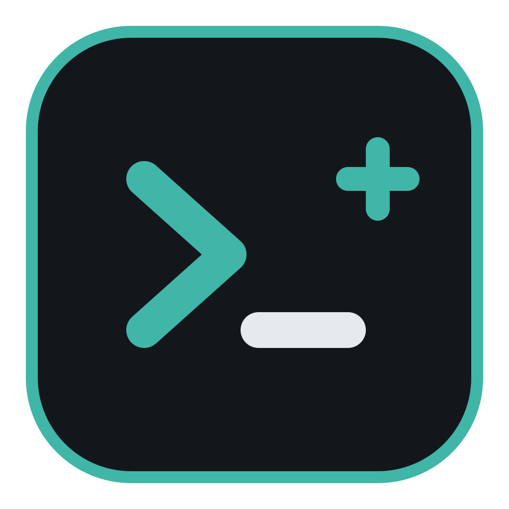
</p>

<h1 align="center">MyShell+</h1>

<p align="center">安全、稳定、可被 Agent 操作的 SSH 客户端</p>

<p align="center">
  
  
  
  
  
</p>

<p align="center">
  <a href="https://cnklpz.github.io/myshellplus/">官网</a> ·
  <a href="#功能">功能</a> ·
  <a href="#截图">截图</a> ·
  <a href="#安全设计">安全</a> ·
  <a href="#稳定性设计">稳定性</a> ·
  <a href="#接入-agent">接入 Agent</a> ·
  <a href="#开发">开发</a>
</p>

<p align="center">
  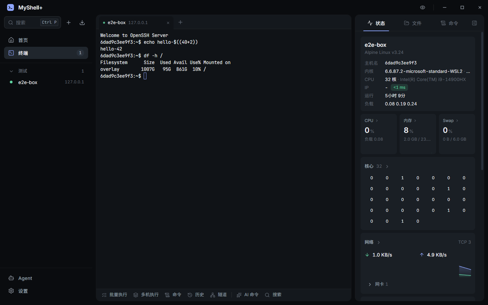
</p>

目前支持 Windows，Android 计划中。

## 功能

| 模块 | 说明 |
|---|---|
| **终端** | 多标签、xterm.js（WebGL 渲染）、搜索、语法高亮、复制粘贴、断线重连 |
| **命令预测** | 历史命令 + 收藏命令 + 内置常用命令实时补全；输入中文直接转命令；可选 AI 预测（`Ctrl+Space`） |
| **AI 命令** | `Ctrl+K` 用自然语言生成命令，选中输出可让 AI 解释；支持 Claude / OpenAI 兼容服务 |
| **状态面板** | CPU / 每核 / 内存 / Swap / 负载 / 网络 / 磁盘 IO / 磁盘 / Top 进程，可自定义卡片 |
| **总览** | 所有服务器一屏实时状态，按分组批量连接 |
| **文件** | SFTP 浏览、上传下载（拖拽）、在线编辑、改权限 |
| **隧道** | 本地转发 `-L`、远程转发 `-R`、动态 SOCKS5 `-D`，可开机自动启动 |
| **批量执行** | 多行命令逐行发送到当前终端 |
| **多机执行** | 多台服务器并发执行，按主机查看输出，失败重试 |
| **命令** | 常用命令收藏，支持 `{{变量:默认值}}` |
| **搜索** | `Ctrl+P` 搜索服务器、终端、命令、历史、隧道、设置 |
| **全局热键** | `Ctrl+Alt+M` 显示/隐藏窗口；``Alt+` `` 按住切换终端（类似 Alt+Tab） |
| **测速** | 单台或全部服务器延迟测试 |
| **导入** | OpenSSH config、PuTTY、Xshell、MobaXterm、FinalShell、1Password、CSV、本软件备份 |
| **SSH Agent** | 支持 1Password、Windows OpenSSH Agent，私钥不离开 Agent |
| **主题** | 多套深色 / 浅色主题 |
| **Agent 接口** | 内置 MCP 服务，Claude Code 等 Agent 可直接列服务器、执行命令、读写文件、操作终端 |

## 截图

<table>
  <tr>
    <td width="50%">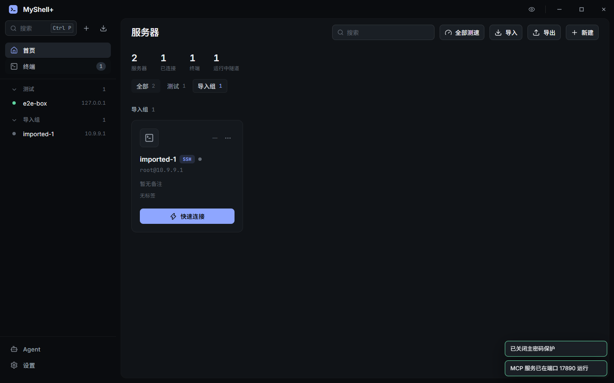<p align="center">服务器分组</p></td>
    <td width="50%">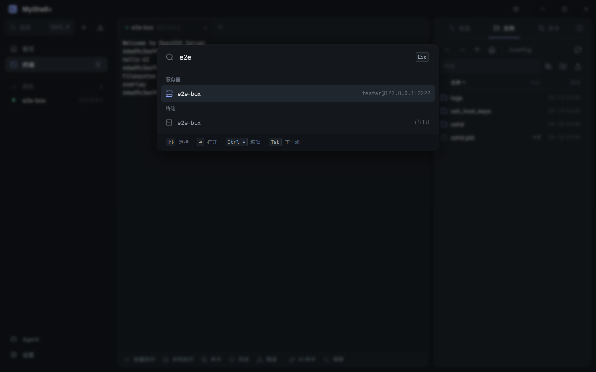<p align="center">全局搜索 <code>Ctrl+P</code></p></td>
  </tr>
  <tr>
    <td>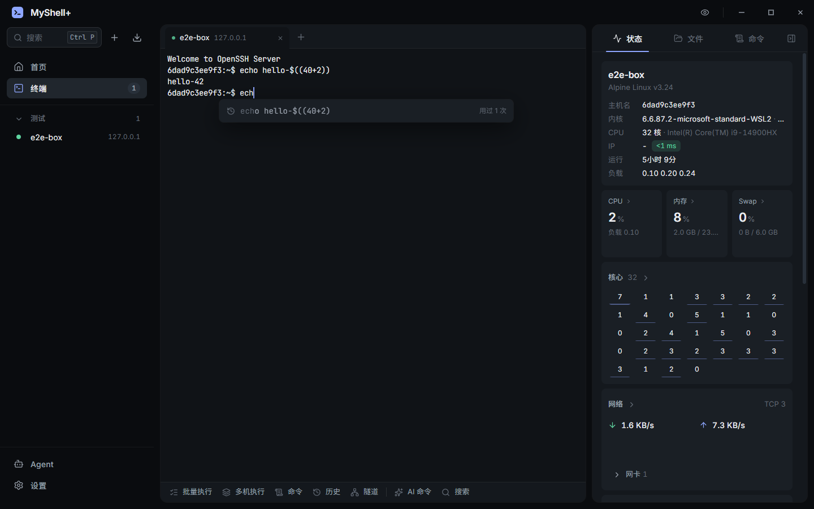<p align="center">命令预测</p></td>
    <td><p align="center">中文转命令</p></td>
  </tr>
  <tr>
    <td>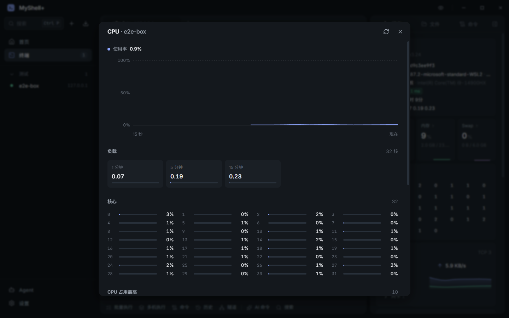<p align="center">CPU 详情</p></td>
    <td>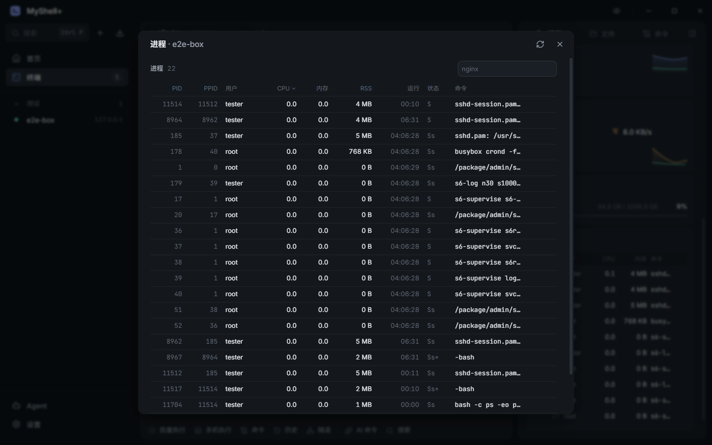<p align="center">进程</p></td>
  </tr>
  <tr>
    <td>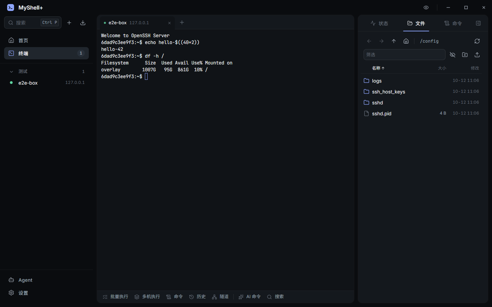<p align="center">SFTP 文件</p></td>
    <td>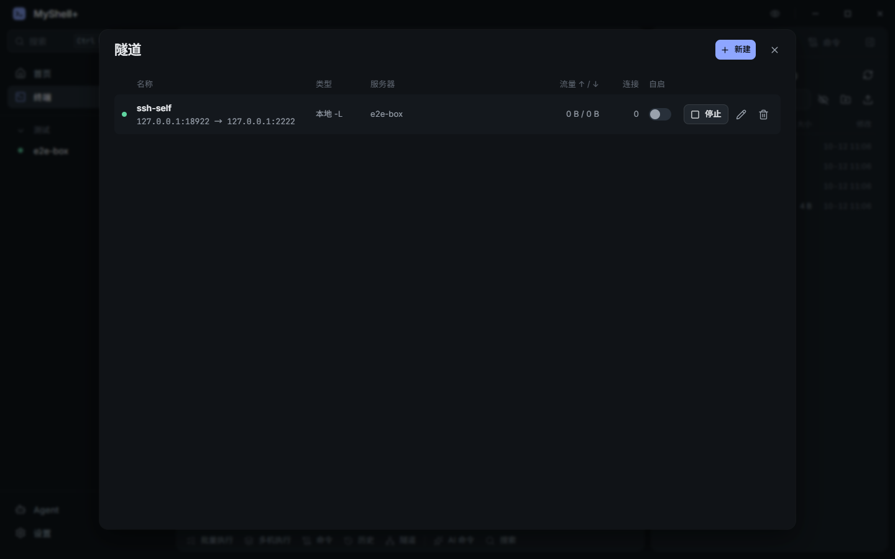<p align="center">隧道</p></td>
  </tr>
  <tr>
    <td>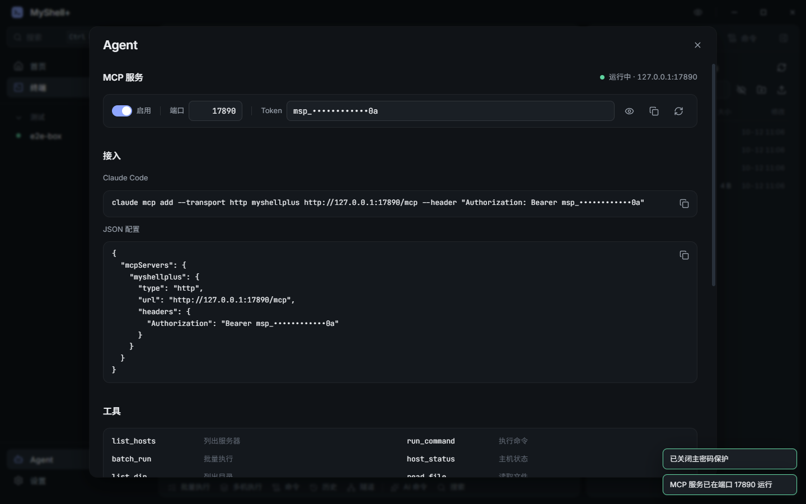<p align="center">MCP 服务</p></td>
    <td>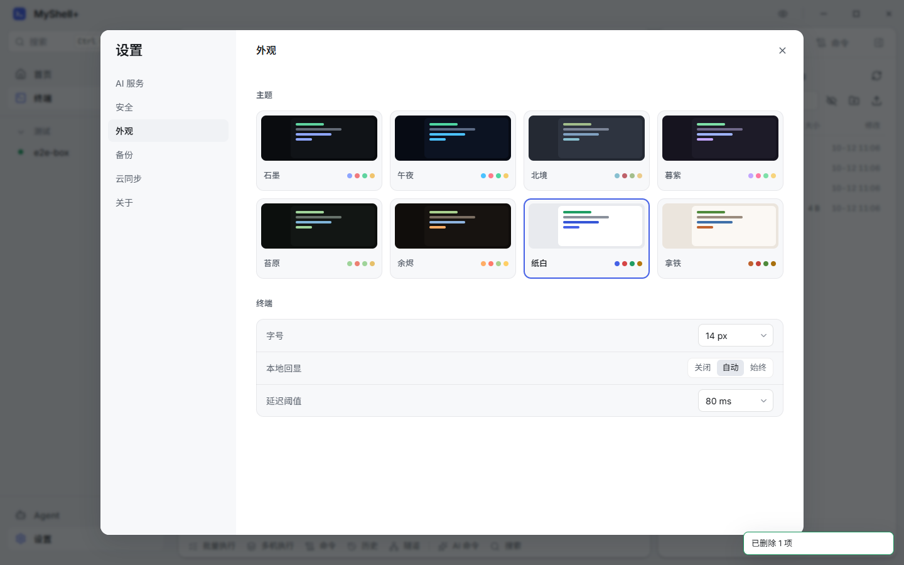<p align="center">主题</p></td>
  </tr>
</table>

## 安全设计

- 所有密码、私钥、API Key 用主密码派生的密钥加密（Argon2id + XChaCha20-Poly1305），磁盘上只有密文
- 可选"在此设备记住"：数据密钥由 Windows DPAPI 保护，只有当前 Windows 账户能解开
- 主机指纹首次连接确认，指纹变化时告警
- Agent 权限按服务器设置：禁止 / 只读 / 每次询问 / 自动（高风险命令仍需确认），全部操作写审计日志
- MCP 服务只监听 `127.0.0.1`，需要 Bearer Token，拒绝浏览器来源请求

## 稳定性设计

SSH 连接、终端会话、隧道全部运行在 Rust 进程里，界面只负责显示：

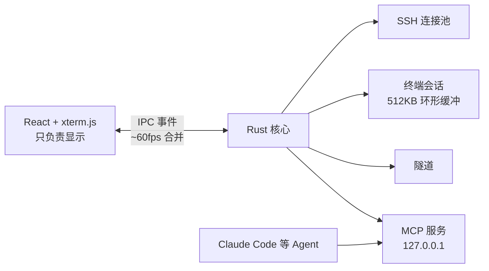

- 终端输出在 Rust 侧环形缓冲（每会话 512KB），界面重载后自动重新接上并回放
- 输出按约 60fps 合并后推送，大量输出不会压垮界面
- 界面心跳看门狗：窗口可见但界面 90 秒无响应（白屏/黑屏）时自动重载界面，连接不受影响
- 图表只保留最近 60 个采样点，终端回滚 5000 行，长时间运行内存稳定

## 接入 Agent

在应用的 **Agent** 页开启 MCP 服务后，复制页面上的命令，例如 Claude Code：

```bash
claude mcp add --transport http myshellplus http://127.0.0.1:17890/mcp --header "Authorization: Bearer <token>"
```

| 工具 | 说明 |
|---|---|
| `list_hosts` | 列出服务器 |
| `run_command` | 执行命令 |
| `batch_run` | 多机执行 |
| `host_status` | 主机状态 |
| `list_dir` / `read_file` / `write_file` | 文件操作 |
| `list_terminals` / `read_terminal` / `send_terminal` | 操作已打开的终端 |

## 开发

```bash
pnpm install
pnpm tauri dev
```

打包：`pnpm tauri build`

```
src-tauri/src/
  ssh/        连接池（跳板机、指纹校验、远程转发回调）、命令执行
  term.rs     终端会话（环形缓冲、输出合并、重连回放）
  monitor.rs  服务器状态采集
  transfer.rs SFTP 与传输
  tunnel.rs   -L / -R / SOCKS5
  batch.rs    批量执行
  predict.rs  命令预测、AI 命令生成
  ai.rs       Claude / OpenAI 兼容接口
  mcp.rs      MCP 服务
  guard.rs    Agent 权限与审计
  vault.rs    加密保险库
  importer.rs 导入与备份
  onepass.rs  SSH Agent 与 1Password
  hotkey.rs   全局热键与终端切换器
  watchdog.rs 界面自愈
src/features/ 各功能界面
e2e/          基于真实应用的端到端测试（WebView2 CDP）
```

## 云同步（规划中）

所有同步表带 `id / updated_at / deleted`，按最后写入合并；密文直接上传，服务器无法解密（端到端加密）。服务端使用自建服务器。
